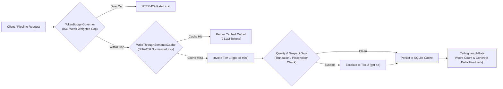

# Deterministic LLM Cost-Router, SHA-256 Write-Through Cache & Self-Healing Length Gate

[](https://github.com/tncyavci/llm-gateway-semantic-cache-cost-router/actions/workflows/ci.yml)
[](https://www.python.org/)
[](https://fastapi.tiangolo.com/)
[](LICENSE)

**A production-grade LLM Gateway & Content Generation Guardrail Middleware implementing SHA-256 Write-Through Localization/Content Caching with Quality-Gate Model Escalation (`gpt-4o-mini` $\to$ `gpt-4o`), ISO-Week Multi-Tenant Weighted Token-Budget Governance, and Ceiling-Targeted Delta-Feedback Length Validation.**

Built to solve three high-cost operational bottlenecks in multi-lingual and content-heavy Applied AI SaaS platforms:
1. **Live Translation & Redundant Generation Drain:** Calling an LLM at request time for repeated UI/curriculum strings adds 800ms+ latency and recurring token cost. A whitespace-normalized SHA-256 write-through cache with automatic quality-gate escalation (`mini` $\to$ `flagship` on suspect outputs) serves 99%+ of reads from SQLite/Postgres in $<1\text{ms}$.
2. **Systematic LLM Word-Count Undershoot ($\approx 0.8\times$):** When prompted for a range such as "400–500 words", frontier models systematically anchor near $0.8\times$ of the lower bound ($\approx 280\text{–}320$ words). Naming the **ceiling** (`500 words`) in the prompt and retrying misses with the exact **concrete word delta** (`+135 words`) rather than hotter temperature brings pass rates to ~100%.
3. **Unbounded Multi-Modal Token Spend:** Audio transcription, high-res vision, and flagship reasoning models have vastly different unit costs. The `TokenBudgetGovernor` enforces ISO-week tenant caps using model-tier cost weights with fail-open telemetry persistence and HTTP 429 enforcement.

---

## System Architecture



---

## Quickstart & Testing

```bash
pip install -e ".[dev]"
pytest -v
uvicorn app:app --reload --port 8000
```
